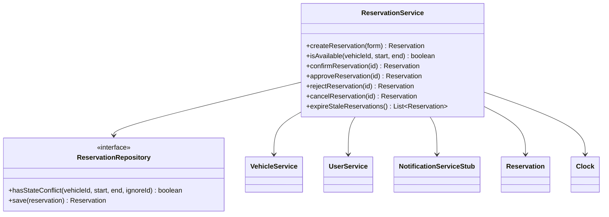

# AutoRepo — Systémová architektura a inženýrská základna

## 1. Technologický stack

- **Runtime:** Java 21 (LTS)
- **Framework:** Spring Boot 3.x
    - `spring-boot-starter-web` (Spring MVC controllers a view resolution)
    - `spring-boot-starter-thymeleaf` (server-side rendered HTML UI)
    - `spring-boot-starter-data-jpa` (Hibernate ORM a repositories)
    - `spring-boot-starter-validation` (Jakarta Bean Validation)
    - `postgresql` runtime driver
- **Frontend UI & Styling:**
    - **Template Engine:** Thymeleaf (standard fragments přes `th:replace`)
    - **Styling Delivery:** Tailwind Play CDN + DaisyUI CSS CDN (načítáno v `base.html`)
    - **Theme Preset:** DaisyUI built-in theme (`data-theme="dim"`)
- **Database:** PostgreSQL 16 (přes Docker Compose)
- **Database Management:** pgAdmin 4 (přes Docker Compose)
- **Testing:** JUnit 5 + Spring Boot Starter Test (`@SpringBootTest`, AssertJ)
- **Build Tool:** Maven

## 2. Architektonický styl a principy

- **Architektonický styl:** Monolitická server-side rendered (SSR) webová aplikace. Bez detached REST API, SPA nebo client-side hydration frameworku, pokud to není výslovně požadováno.
- **Organizační vzor:** Přísné **Package-by-Feature**. Business domény jsou modularizované nezávisle, ne rozdělené do horizontálních layer složek.
- **Layer discipline:** V rámci každé feature se závislosti pohybují striktně dolů: `Controller` → `Service` → `Repository` → `Database`.
- **Base package:** `cz.vsb.autarepo.autorepo`

## 3. Backend package hierarchy & blueprint

Kořen aplikace obsahuje technickou infrastrukturu, cross-cutting concerns a feature moduly:

```text
cz.vsb.autarepo.autorepo/
├── AutoRepoApplication.java            # Spring Boot entry point & component scan root
├── config/                             # Technická konfigurace (WebMvcConfig, apod.)
├── common/                             # Cross-cutting concerns
│   ├── domain/                         # Domain rules, shared invariants
│   └── exception/                      # Global exception handlers & base error models
├── feature/                            # Domain moduly
│   └── <feature_name>/                 # Izolovaný feature package
│       ├── <FeatureName>.java          # JPA Entity (mapped to primary table)
│       ├── <FeatureName>Repository.java# Spring Data JPA Repository
│       ├── <FeatureName>Service.java   # Domain logic & @Transactional boundary
│       ├── <FeatureName>ViewController.java # Spring MVC @Controller
│       ├── <FeatureName>State.java     # (Volitelné) lifecycle enum
│       └── dto/
│           ├── <FeatureName>Form.java  # Java 21 record pro validované form binding
│           └── <FeatureName>Response.java # (Volitelné) read-only projection record
├── templates/
│   ├── layout/
│   ├── components/
│   └── feature/
├── static/
└── ...
```

## 4. Architektonické hranice a pravidla komunikace

1. **Směr přístupu layerů:**
    - Přísný dolů směřující tok: `ViewController` → `Service` → `Repository` → Database.
    - Controllers nesmí přímo injectovat ani volat Repositories.
2. **Izolace mezi feature:**
    - Komunikace mezi features musí probíhat výhradně přes veřejné **Service** interfaces.
    - Service v `feature.A` nesmí přímo dotazovat nebo injectovat repository patřící `feature.B`.
3. **Data Transfer & Form Binding:**
    - HTTP formuláře musí být navázané na Java 21 `record` DTO validované přes Jakarta Bean Validation (`@Valid`, `@NotNull`, `@NotBlank`, apod.).
    - JPA entity nesmí být použita jako přímé form-backing objekty v controllerech.

## 5. Presentation Architecture (Thymeleaf, Tailwind CSS, DaisyUI)

UI vrstva je renderovaná na serveru přes Thymeleaf a stylovaná přes Tailwind CSS a DaisyUI komponenty bez Node.js build procesu.

### Hierarchie view a layout pattern

```text
src/main/resources/
├── static/
│   ├── css/                            # Custom CSS overrides (pokud potřeba)
│   ├── js/                             # Shared client scripts (theme toggles, modal helpers)
│   └── images/                         # Static image assets
│
└── templates/
    ├── layout/                         # Shared skeleton layouts
    │   └── base.html                   # Master HTML shell (head, CDN links, body slots)
    ├── components/                     # Atomic, reusable UI fragments (alerts, navbars, form inputs)
    ├── error/                          # HTTP status views (404.html, 500.html)
    └── feature/                        # Feature-specific view directories
        └── <feature_name>/             # Screens belonging to domain (list.html, form.html)
```

### UI Integration Standards

- **Controller View Resolution:** MVC controllery musí vracet pathy s prefixem feature složky:
  `return "feature/<feature_name>/<view_name>";`
- **Layout Skeletons:** Standardní views musí injectovat obsah do `templates/layout/base.html` pomocí standardního Thymeleaf layout replacement (`th:replace="~{layout/base :: ...}"`).
- **CDN Loading Order:** Všechny externí frontend scripts a stylesheety jsou umístěné pouze v `templates/layout/base.html`. Tailwind CDN script se načítá před DaisyUI CDN linkem.
- **Component Reuse:** Běžné UI struktury (alert boxy, navbar, form input wrapper s error spans) musí být implementovány jako parameterizované Thymeleaf fragments v `templates/components/`.

## C05 Detailed Design

### Vybraná architektonická jednotka

**Reservation lifecycle responsibility**, implementovaná především v
`cz.vsb.autarepo.autorepo.feature.reservation.ReservationService`.

Související požadavky a scénáře:

- OP-01 Create Reservation
- OP-02 Check Availability
- OP-03 Confirm Reservation
- OP-04 Cancel Reservation
- OP-05 Approve Reservation
- OP-06 Reject Reservation
- OP-07 Expire Pending Reservation
- BR-01/BR-02 half-open interval exclusivity
- BR-03 cancellation cutoff
- BR-04 draft non-allocation
- BR-05 approval routing
- BR-06 pending approval expiration
- BR-Domain future start and maximum duration

### Detailní odpovědnosti

| Odpovědnost | Vlastník | Proč je to potřeba |
|---|---|---|
| Validace reservation window | `ReservationService` + `ReservationRules` | Zabraňuje null, zero-length, inverted, past-start a over-14-day intervalům před persistencí nebo availability checkem. |
| Řešení vehicle a user referencí | `VehicleService` / `UserService` | Udržuje cross-feature přístup za `VehicleService` a `UserService`, ne přes cizí repositories. |
| Kontrola exkluzivní dostupnosti | `ReservationRepository` + `ReservationService` | Aplikuje half-open overlap semantics pro blocking reservation states a vylučuje aktuální reservation při promoci. |
| Routing potvrzení rezervace | `ReservationService` | Potvrzení standardních vozidel probíhá přímo, approval-required vozidla jsou směrována do `PENDING_APPROVAL`. |
| Provádění lifecycle transitions | `ReservationService` + `Reservation` | Schvaluje, odmítá, zruší nebo expirované rezervace pouze z povolených stavů a časových oken. |
| Persist a notify | `ReservationRepository` + `NotificationServiceStub` | Ukládá změny stavu, flushuje transakčně a volá notification boundary pro externě viditelné přechody. |

### Design elements and ownership

| Odpovědnost | Vlastník | State/data | Proč tady? |
|---|---|---|---|
| Lifecycle orchestration a business policy | `ReservationService` | `Clock`, reservation state, start/end, vehicle policy | Centralizuje rozhodnutí a zajišťuje deterministický čas v testech. |
| Persistent reservation access | `ReservationRepository` | `Reservation` rows a JPQL overlap query | Encapsuluje přístup k datům a blokující stavy. |
| Vehicle/user lookup a locking | `VehicleService`, `UserService` | `Vehicle.requiresApproval`, `Vehicle.isActive`, user identity | Vynucuje service boundary mezi feature. |
| Lifecycle state | `Reservation` a `ReservationState` | `DRAFT`, `PENDING_APPROVAL`, `CONFIRMED`, `REJECTED`, `CANCELLED`, `EXPIRED` | Entita uchovává stav a lifecycle timestamps. |
| External notification boundary | `NotificationServiceStub` | Transition event a reservation | Udržuje messaging mimo persistence a controller kód. |
| Time source | `config.TimeConfig` | UTC `Clock` bean | Zabraňuje přímému volání system time v service orchestration. |

### Klíčové interface / contract

Významnou persistence kontrakt tvoří `ReservationRepository`:

```text
hasStateConflict(vehicleId, startTime, endTime, ignoreReservationId) : boolean
```

Contract:

- Preconditions: vehicle a interval identifikují reservation query; interval musí mít `startTime < endTime`.
- Behavior: vrátí `true` pouze tehdy, pokud jiná rezervace pro stejný vehicle má blocking state a splňuje
  `existing.startTime < requested.endTime` a `existing.endTime > requested.startTime`.
- Blocking states: `CONFIRMED` a `PENDING_APPROVAL`.
- Postcondition: adjacent intervals vrací `false`; ignorovaný reservation ID není brán jako konflikt.
- Failure behavior: neplatné lifecycle požadavky jsou odmítnuty `ReservationService` s explicitními error kódy.

Veřejné `ReservationService` operace tvoří application-facing lifecycle contract:
`createReservation`, `isAvailable`, `confirmReservation`, `approveReservation`,
`rejectReservation`, `cancelReservation`, a `expireStaleReservations`.

### Focused structural view



### Důležité metody / operace

| Operace | Preconditions | Postconditions / side effects | Failure behavior |
|---|---|---|---|
| `createReservation(form)` | Valid vehicle/user; `start < end`; `start > now`; duration `<= 14 days`. | Persistuje `DRAFT` rezervaci s UTC-based `createdAt`. | `INVALID_INTERVAL`, `START_MUST_BE_FUTURE`, `MAX_DURATION_EXCEEDED`, nebo inactive-resource error. |
| `isAvailable(vehicleId, start, end)` | Valid future interval within 14 days. | Vrátí dostupnost na základě blocking overlap query; drafts neblokují. | Stejné validation failures. |
| `confirmReservation(id)` | Reservation je `DRAFT`; vehicle je active. | Standardní vehicle je `CONFIRMED`; approval-required vehicle je `PENDING_APPROVAL` s review deadline. Sends příslušné notification. | `INVALID_STATE_TRANSITION` nebo `CONFLICT_OVERLAP`. |
| `approveReservation(id)` | Reservation je `PENDING_APPROVAL`; `now < startTime` a review deadline. | Stává se `CONFIRMED`; sends confirmation notification. | Na hranici expirace se stává `EXPIRED`, notifies a hází `APPROVAL_WINDOW_EXPIRED`. |
| `rejectReservation(id)` | Reservation je `PENDING_APPROVAL`. | Stává se `REJECTED`; sends rejection notification. | `INVALID_STATE_TRANSITION`. |
| `cancelReservation(id)` | Reservation je cancellable a `now < startTime`. | Stává se `CANCELLED`; sends cancellation notification a uvolní lock. | `CANCELLATION_WINDOW_CLOSED` nebo `INVALID_STATE_TRANSITION`. |

### Algorithm / decision logic

```text
validateWindow(start, end, now):
    if start or end is null, or start >= end:
        fail INVALID_INTERVAL
    if start <= now:
        fail START_MUST_BE_FUTURE
    if duration(start, end) > 14 days:
        fail MAX_DURATION_EXCEEDED

confirm(draft):
    if draft.state != DRAFT:
        fail INVALID_STATE_TRANSITION
    if repository.hasStateConflict(vehicle, interval, draft.id):
        fail CONFLICT_OVERLAP
    if vehicle.requiresApproval:
        draft.state = PENDING_APPROVAL
        draft.reviewDeadline = min(now + review SLA, draft.start)
        notify pending approval
    else:
        draft.state = CONFIRMED
        notify confirmed

approve(pending):
    if now >= pending.start or now >= pending.reviewDeadline:
        pending.state = EXPIRED
        notify expired
        fail APPROVAL_WINDOW_EXPIRED
    re-check blocking overlap
    pending.state = CONFIRMED
    notify confirmed
```

### Detailní sekvence: luxury confirmation

```text
ViewController
  -> ReservationService.confirmReservation(id)
  -> ReservationService.findById(id)
  -> VehicleService.findByIdForUpdate(vehicleId)
  -> ReservationRepository.hasStateConflict(vehicleId, start, end, id)
  -> Reservation.requestApproval(now)
  -> ReservationRepository.save + flush
  -> NotificationServiceStub.notifyReservationPendingApproval(reservation)
  <- PENDING_APPROVAL reservation
```

### DD decisions intentionally left to code/frameworks

- JPA entity mapping, generated IDs, fetch strategy a transaction implementation details.
- Thymeleaf rendering a HTTP redirect mechanics.
- Notification transport beyond current stub adapter.
- Database-specific DDL generation a connection pooling.
- Scheduler cadence; service zůstává owner expiration eligibility.

### Design ↔ implementation assessment

Hlavní lifecycle, overlap, approval, cancellation, expiration, UTC clock a notification decyzí jsou implementované v
`ReservationService`, `ReservationRepository`, `ReservationRules`, `TimeConfig` a reservation tests.

Aktuální stav implementace:

- `ReservationService` vlastní orchestration boundary a deleguje rule evaluation do `ReservationRules`.
- `ReservationRules` obsahuje reusable invariants (`validateReservationWindow`, `shouldExpire`, `canCancel`, overlap helpers), což je v souladu s přijatým designem, ne s drift.
- `TimeConfig` injectuje UTC `Clock` bean, který je použit `ReservationService` pro deterministický čas.
- Repository-level a lifecycle-level testy validují tyto rozhodnutí a jsou v souladu s architekturou, jak je implementovaná.

Jinými slovy, design a implementace jsou aktuálně v souladu s repository stavem, který je zvažován. Zbývající riziko není architektonický drift, ale důkaz provedení concurrency a scheduler behavior před CP2 sign-off.

---

## ADR-01 — Monolitická SSR architektura s package-by-feature ownership

### Status
Přijato.

### Context
Projekt musí dodat systém rezervace vozidel se silnými business invariants, včetně:

- exkluzivní alokace vozidla pro překrývající se intervaly
- approval-required směrování pro luxusní nebo omezené zásoby
- cancellation windows a scheduler-based expiry path
- jednoduchý, ale evidence-based deployment model pro malý tým
- UI, které lze ověřit server-side renderingem a minimální infra setup

Systém musí také zůstat srozumitelný pro malý vývojový tým při plnění přísných projektových constraintů ohledně validace, business rules a testability.

### Decision
Vybudujeme aplikaci jako jeden Spring Boot monolith s následujícími principy:

- Java 21 + Spring Boot 3
- PostgreSQL jako jediný persistent data store
- package-by-feature organizace (`cz.vsb.autarepo.autorepo.feature.*`)
- přísný downward layer flow: `Controller -> Service -> Repository -> Database`
- Thymeleaf + Tailwind CSS + DaisyUI pro UI vrstvu
- service-owned domain logic, s repository přístupem izolovaným přes feature services

### Alternatives considered

#### Alternative A — Microservice architecture
- Pros: scale, nezávislé deploymenty, oddělené boundaries ownershipu
- Cons: zbytečná složitost pro single-domain booking systém; vyšší operativní náklady; složitější udržení transactionální konzistence pro overlap a approval flows

#### Alternative B — SPA / REST-first frontend s oddělenou API vrstvou
- Pros: moderní UI architektura a frontend separace
- Cons: další složitost a více pohyblivých částí pro projekt s malým týmem a silnou potřebou přímé validace business rules; není to požadováno projektem

#### Alternative C — Monolitická architektura bez přísného package ownership
- Pros: jednodušší počáteční implementace
- Cons: vyšší riziko coupling, složitější vynucování pravidel a architektonický drift mezi business logic a persistence vrstvou

### Consequences

Positive:
- jednodušší deployment a debugging
- lepší sladění mezi dokumentací požadavků a implementací
- silnější transactionální konzistence pro lifecycle transitions rezervací
- rychlejší validace přes integration testy a repository evidence

Negative:
- monolith bude potřebovat disciplínu, aby se zabránilo feature coupling a service sprawl
- concurrency a expiry behavior stále musí být dokazovány testy před release sign-off
- architektura je záměrně jednoduchá, takže není nejlepší volba pro velké multi-team scale-out scénáře

### Rationale
Tento projekt je ohraničená business doména s jedním hlavním transakčním workflow a silnými business invariants. Monolitická package-by-feature struktura je nejlepší volba, protože udržuje domain logic snadno testovatelnou, přidává minimální distribučovanou složitost a přímo podporuje požadovaný evidence model pro projekt C06/C08 status.

---

## DD (Deferred Design Decisions)

Následující rozhodnutí jsou úmyslně ponechána na kód / framework, protože nejsou klíčovým architektonickým rozhodnutím projektu:

- JPA entity mapping, generated IDs, fetch strategy a transaction implementation details.
- Thymeleaf rendering a HTTP redirect mechanisms.
- Notification transport beyond current stub adapter.
- Database-specific DDL generation a connection pooling.
- Scheduler cadence; service zůstává owner expiration eligibility.

Tyto body jsou důležité pro implementaci, ale ne mění základní architektonickou volbu systému. Rozhodnutí o nich lze upravit později v rámci kódu, pokud to vyžaduje provozní nebo technická potřeba.

---

## Shrnutí

Architektura je záměrně jednoduchá, ale disciplinovaná:
- jedna Spring Boot aplikace
- jeden PostgreSQL datastore
- jedna doménově orientovaná feature struktura
- jasné ownership a přísný downward dependency flow

AS-IS stav byl funkční prototyp, který potřeboval lepší vynucení hranic; TO-BE stav je disciplinovaná, evidence-based architektura, která odpovídá business rules, testability požadavkům a projektovým omezením. Vybraná alternativa je správná pro tento rozsah, protože udržuje rezervní doménu konzistentní a zároveň zviditelňuje business invariants a jejich ověřování.
