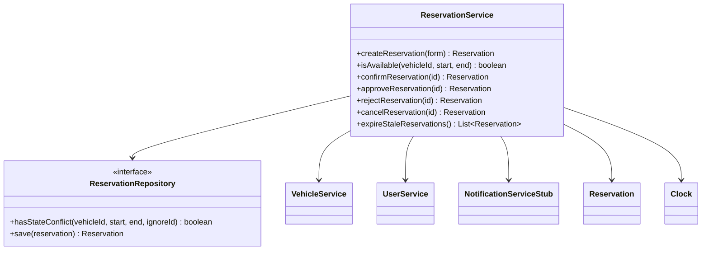

# AutoRepo — System Architecture & Engineering Baseline

## 1. Technical Stack

- **Runtime:** Java 21 (LTS)
- **Framework:** Spring Boot 3.x
    - `spring-boot-starter-web` (Spring MVC controllers & view resolution)
    - `spring-boot-starter-thymeleaf` (Server-side rendered HTML UI)
    - `spring-boot-starter-data-jpa` (Hibernate ORM & repositories)
    - `spring-boot-starter-validation` (Jakarta Bean Validation)
    - `postgresql` runtime driver
- **Frontend UI & Styling:**
    - **Template Engine:** Thymeleaf (Standard fragments via `th:replace`)
    - **Styling Delivery:** Tailwind Play CDN + DaisyUI CSS CDN (loaded in `base.html`)
    - **Theme Preset:** DaisyUI built-in theme (`data-theme="dim"`)
- **Database:** PostgreSQL 16 (via Docker Compose)
- **Database Management:** pgAdmin 4 (via Docker Compose)
- **Testing:** JUnit 5 + Spring Boot Starter Test (`@SpringBootTest`, AssertJ)
- **Build Tool:** Maven

## 2. Architectural Style & Principles

- **Architectural Style:** Monolithic Server-Side Rendered (SSR) Web Application. No detached REST APIs, SPAs, or client-side hydration frameworks unless explicitly requested.
- **Organization Pattern:** Strict **Package-by-Feature**. Business verticals are modularized independently rather than split across horizontal layer folders.
- **Layered Discipline:** Within each feature, dependencies flow strictly downward: `Controller` → `Service` → `Repository` → `Database`.
- **Base Package:** `cz.vsb.autarepo.autorepo`

## 3. Backend Package Hierarchy & Blueprint

The application root contains technical infrastructure, cross-cutting concerns, and feature modules:

```text
cz.vsb.autarepo.autorepo/
├── AutoRepoApplication.java            # Spring Boot entry point & component scan root
├── config/                             # Technical configuration (WebMvcConfig, etc.)
├── common/                             # Cross-cutting concerns
│   └── exception/                      # Global exception handlers & base error models
└── feature/                            # Domain modules
    └── <feature_name>/                 # Isolated feature package
        ├── <FeatureName>.java          # JPA Entity (mapped to primary table)
        ├── <FeatureName>Repository.java# Spring Data JPA Repository
        ├── <FeatureName>Service.java   # Domain logic & @Transactional boundary
        ├── <FeatureName>ViewController.java # Spring MVC @Controller
        ├── <FeatureName>State.java     # (Optional) Lifecycle enum
        └── dto/
            ├── <FeatureName>Form.java  # Java 21 record for validated form binding
            └── <FeatureName>Response.java # (Optional) Read-only projection record
```

## 4. Architectural Boundaries & Communication Rules

1. **Layer Access Direction:**
    - Strict downward flow: `ViewController` → `Service` → `Repository` → Database.
    - Controllers must never inject or call Repositories directly.
2. **Cross-Feature Isolation:**
    - Inter-feature communication must occur exclusively via public **Service** interfaces.
    - A service in `feature.A` must never directly query or inject a repository belonging to `feature.B`.
3. **Data Transfer & Form Binding:**
    - HTTP form submissions must bind to Java 21 `record` DTOs validated via Jakarta Bean Validation (`@Valid`, `@NotNull`, `@NotBlank`, etc.).
    - JPA entities must never serve as direct form-backing objects in controllers.

## 5. Presentation Architecture (Thymeleaf, Tailwind CSS, DaisyUI)

The UI layer is server-side rendered using Thymeleaf and styled via Tailwind CSS and DaisyUI component classes without a Node.js build step.

### View Hierarchy & Layout Pattern

```text
src/main/resources/
├── static/
│   ├── css/                            # Custom CSS overrides (if needed)
│   ├── js/                             # Shared client scripts (theme toggles, modal helpers)
│   └── images/                         # Static image assets
│
└── templates/
    ├── layout/                         # Shared skeleton layouts
    │   └── base.html                   # Master HTML shell (head, CDN links, body slots)
    ├── components/                     # Atomic, reusable UI fragments (alerts, navbars, form inputs)
    ├── error/                          # HTTP status views (404.html, 500.html)
    └── feature/                        # Feature-specific view directories
        └── <feature_name>/             # Screens belonging to domain (list.html, form.html)
```

### UI Integration Standards

- **Controller View Resolution:** MVC controllers must return paths prefixed with the feature folder:
  `return "feature/<feature_name>/<view_name>";`
- **Layout Skeletons:** Standard views must inject their content into `templates/layout/base.html` using standard Thymeleaf layout replacement (`th:replace="~{layout/base :: ...}"`).
- **CDN Loading Order:** All external frontend scripts and stylesheets reside solely in `templates/layout/base.html`. Load Tailwind's CDN script before DaisyUI's CDN link.
- **Component Reuse:** Common UI structures (alert boxes, navbar, form input wrappers with error spans) must be implemented as parameterized Thymeleaf fragments inside `templates/components/`.

## C05 Detailed Design

### Selected architecture unit

**Reservation lifecycle responsibility**, implemented primarily by
`cz.vsb.autarepo.autorepo.feature.reservation.ReservationService`.

Related requirements and scenarios:

- OP-01 Create Reservation
- OP-02 Check Availability
- OP-03 Confirm Reservation
- OP-04 Cancel Reservation
- OP-05 Approve Reservation
- OP-06 Reject Reservation
- OP-07 Expire Pending Reservation
- BR-01/BR-02 half-open interval exclusivity
- BR-03 cancellation cutoff
- BR-04 draft non-allocation
- BR-05 approval routing
- BR-06 pending approval expiration
- BR-Domain future start and maximum duration

### Detailed responsibilities

| Responsibility | Why it is needed |
|---|---|
| Validate reservation windows | Prevent null, zero-length, inverted, past-start, and over-14-day intervals before persistence or availability checks. |
| Resolve vehicle and user references | Keep cross-feature access behind `VehicleService` and `UserService`, not foreign repositories. |
| Check exclusive availability | Apply half-open overlap semantics to blocking reservation states and exclude the current reservation during promotion. |
| Route confirmation requests | Confirm standard vehicles directly and route approval-required vehicles to `PENDING_APPROVAL`. |
| Execute lifecycle transitions | Approve, reject, cancel, or expire reservations only from permitted states and temporal windows. |
| Persist and notify | Save state changes, flush transactionally, and invoke the notification boundary for externally visible transitions. |

### Design elements and ownership

| Responsibility | Owner | State/data | Why here? |
|---|---|---|---|
| Lifecycle orchestration and business policy | `ReservationService` | `Clock`, reservation state, start/end, vehicle policy | Centralizes decisions and makes time deterministic in tests. |
| Persistent reservation access | `ReservationRepository` | `Reservation` rows and JPQL overlap query | Encapsulates persistence and blocking-state selection. |
| Vehicle/user lookup and locking | `VehicleService`, `UserService` | `Vehicle.requiresApproval`, `Vehicle.isActive`, user identity | Enforces cross-feature service boundaries. |
| Lifecycle state | `Reservation` and `ReservationState` | `DRAFT`, `PENDING_APPROVAL`, `CONFIRMED`, `REJECTED`, `CANCELLED`, `EXPIRED` | Entity stores the aggregate state and lifecycle timestamps. |
| External notification boundary | `NotificationServiceStub` | Transition event and reservation | Keeps messaging out of persistence and controller code. |
| Time source | `config.TimeConfig` | UTC `Clock` bean | Prevents direct system-time calls in service orchestration. |

### Key interface / contract

The significant persistence contract is `ReservationRepository`:

```text
hasStateConflict(vehicleId, startTime, endTime, ignoreReservationId) : boolean
```

Contract:

- Preconditions: vehicle and interval identify a reservation query; interval has `startTime < endTime`.
- Behavior: return `true` only when another reservation for the vehicle has a blocking state and satisfies
  `existing.startTime < requested.endTime` and `existing.endTime > requested.startTime`.
- Blocking states: `CONFIRMED` and `PENDING_APPROVAL`.
- Postcondition: adjacent intervals return `false`; the ignored reservation ID is not considered a conflict.
- Failure behavior: invalid lifecycle requests are rejected by `ReservationService` with explicit error codes.

The public `ReservationService` operations form the application-facing lifecycle contract:
`createReservation`, `isAvailable`, `confirmReservation`, `approveReservation`,
`rejectReservation`, `cancelReservation`, and `expireStaleReservations`.

### Focused structural view



### Important methods / operations

| Operation | Preconditions | Postconditions / side effects | Failure behavior |
|---|---|---|---|
| `createReservation(form)` | Valid vehicle/user; `start < end`; `start > now`; duration `<= 14 days`. | Persists a `DRAFT` reservation with UTC-based `createdAt`. | `INVALID_INTERVAL`, `START_MUST_BE_FUTURE`, `MAX_DURATION_EXCEEDED`, or inactive-resource error. |
| `isAvailable(vehicleId, start, end)` | Valid future interval within 14 days. | Returns availability based on blocking overlap query; drafts do not block. | Same interval validation failures. |
| `confirmReservation(id)` | Reservation is `DRAFT`; vehicle is active. | Standard vehicle becomes `CONFIRMED`; approval-required vehicle becomes `PENDING_APPROVAL` with review deadline. Sends the corresponding notification. | `INVALID_STATE_TRANSITION` or `CONFLICT_OVERLAP`. |
| `approveReservation(id)` | Reservation is `PENDING_APPROVAL`; `now < startTime` and review deadline. | Becomes `CONFIRMED`; sends confirmation notification. | At or after expiry boundary, becomes `EXPIRED`, notifies, and throws `APPROVAL_WINDOW_EXPIRED`. |
| `rejectReservation(id)` | Reservation is `PENDING_APPROVAL`. | Becomes `REJECTED`; sends rejection notification. | `INVALID_STATE_TRANSITION`. |
| `cancelReservation(id)` | Reservation is cancellable and `now < startTime`. | Becomes `CANCELLED`; sends cancellation notification and releases its lock. | `CANCELLATION_WINDOW_CLOSED` or `INVALID_STATE_TRANSITION`. |

### Algorithm / decision logic

```text
validateWindow(start, end, now):
    if start or end is null, or start >= end:
        fail INVALID_INTERVAL
    if start <= now:
        fail START_MUST_BE_FUTURE
    if duration(start, end) > 14 days:
        fail MAX_DURATION_EXCEEDED

confirm(draft):
    if draft.state != DRAFT:
        fail INVALID_STATE_TRANSITION
    if repository.hasStateConflict(vehicle, interval, draft.id):
        fail CONFLICT_OVERLAP
    if vehicle.requiresApproval:
        draft.state = PENDING_APPROVAL
        draft.reviewDeadline = min(now + review SLA, draft.start)
        notify pending approval
    else:
        draft.state = CONFIRMED
        notify confirmed

approve(pending):
    if now >= pending.start or now >= pending.reviewDeadline:
        pending.state = EXPIRED
        notify expired
        fail APPROVAL_WINDOW_EXPIRED
    re-check blocking overlap
    pending.state = CONFIRMED
    notify confirmed
```

### Detailed sequence: luxury confirmation

```text
ViewController
  -> ReservationService.confirmReservation(id)
  -> ReservationService.findById(id)
  -> VehicleService.findByIdForUpdate(vehicleId)
  -> ReservationRepository.hasStateConflict(vehicleId, start, end, id)
  -> Reservation.requestApproval(now)
  -> ReservationRepository.save + flush
  -> NotificationServiceStub.notifyReservationPendingApproval(reservation)
  <- PENDING_APPROVAL reservation
```

### DD decisions intentionally left to code/frameworks

- JPA entity mapping, generated IDs, fetch strategy, and transaction implementation details.
- Thymeleaf rendering and HTTP redirect mechanics.
- Notification transport beyond the current stub adapter.
- Database-specific DDL generation and connection pooling.
- Scheduler cadence; the service remains the owner of expiration eligibility.

### Design ↔ implementation assessment

The main lifecycle, overlap, approval, cancellation, expiration, UTC clock, and notification decisions are implemented in
`ReservationService`, `ReservationRepository`, `TimeConfig`, and the reservation tests. One deliberate mismatch remains:
`Reservation` and `ReservationRules` still contain reusable state-transition and cancellation predicates. They should either be
retained as aggregate guards and treated as lower-level invariant helpers, or moved fully into `ReservationService` if the
strict interpretation of “all domain rules exclusively in the service” is required.
