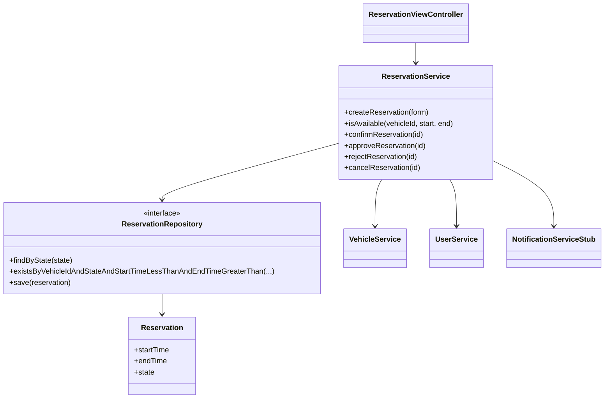
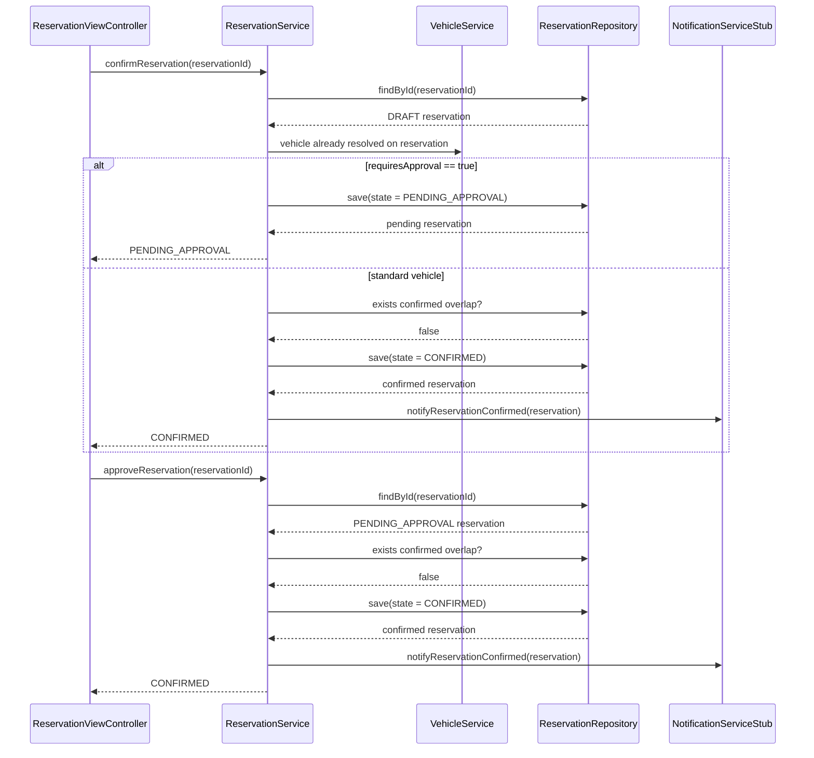

# AutoRepo — System Architecture & Engineering Baseline

## 1. Technical Stack

- **Runtime:** Java 21 (LTS)
- **Framework:** Spring Boot 3.x
    - `spring-boot-starter-web` (Spring MVC controllers & view resolution)
    - `spring-boot-starter-thymeleaf` (Server-side rendered HTML UI)
    - `spring-boot-starter-data-jpa` (Hibernate ORM & repositories)
    - `spring-boot-starter-validation` (Jakarta Bean Validation)
    - `postgresql` runtime driver
- **Frontend UI & Styling:**
    - **Template Engine:** Thymeleaf (Standard fragments via `th:replace`)
    - **Styling Delivery:** Tailwind Play CDN + DaisyUI CSS CDN (loaded in `base.html`)
    - **Theme Preset:** DaisyUI built-in theme (`data-theme="dim"`)
- **Database:** PostgreSQL 16 (via Docker Compose)
- **Database Management:** pgAdmin 4 (via Docker Compose)
- **Testing:** JUnit 5 + Spring Boot Starter Test (`@SpringBootTest`, AssertJ)
- **Build Tool:** Maven

## 2. Architectural Style & Principles

- **Architectural Style:** Monolithic Server-Side Rendered (SSR) Web Application. No detached REST APIs, SPAs, or client-side hydration frameworks unless explicitly requested.
- **Organization Pattern:** Strict **Package-by-Feature**. Business verticals are modularized independently rather than split across horizontal layer folders.
- **Layered Discipline:** Within each feature, dependencies flow strictly downward: `Controller` → `Service` → `Repository` → `Database`.
- **Base Package:** `cz.vsb.autarepo.autorepo`

## 3. Backend Package Hierarchy & Blueprint

The application root contains technical infrastructure, cross-cutting concerns, and feature modules:

```text
cz.vsb.autarepo.autorepo/
├── AutoRepoApplication.java            # Spring Boot entry point & component scan root
├── config/                             # Technical configuration (WebMvcConfig, etc.)
├── common/                             # Cross-cutting concerns
│   └── exception/                      # Global exception handlers & base error models
└── feature/                            # Domain modules
    └── <feature_name>/                 # Isolated feature package
        ├── <FeatureName>.java          # JPA Entity (mapped to primary table)
        ├── <FeatureName>Repository.java# Spring Data JPA Repository
        ├── <FeatureName>Service.java   # Domain logic & @Transactional boundary
        ├── <FeatureName>ViewController.java # Spring MVC @Controller
        ├── <FeatureName>State.java     # (Optional) Lifecycle enum
        └── dto/
            ├── <FeatureName>Form.java  # Java 21 record for validated form binding
            └── <FeatureName>Response.java # (Optional) Read-only projection record
```

## 4. Architectural Boundaries & Communication Rules

1. **Layer Access Direction:**
    - Strict downward flow: `ViewController` → `Service` → `Repository` → Database.
    - Controllers must never inject or call Repositories directly.
2. **Cross-Feature Isolation:**
    - Inter-feature communication must occur exclusively via public **Service** interfaces.
    - A service in `feature.A` must never directly query or inject a repository belonging to `feature.B`.
3. **Data Transfer & Form Binding:**
    - HTTP form submissions must bind to Java 21 `record` DTOs validated via Jakarta Bean Validation (`@Valid`, `@NotNull`, `@NotBlank`, etc.).
    - JPA entities must never serve as direct form-backing objects in controllers.

## 5. Presentation Architecture (Thymeleaf, Tailwind CSS, DaisyUI)

The UI layer is server-side rendered using Thymeleaf and styled via Tailwind CSS and DaisyUI component classes without a Node.js build step.

### View Hierarchy & Layout Pattern

```text
src/main/resources/
├── static/
│   ├── css/                            # Custom CSS overrides (if needed)
│   ├── js/                             # Shared client scripts (theme toggles, modal helpers)
│   └── images/                         # Static image assets
│
└── templates/
    ├── layout/                         # Shared skeleton layouts
    │   └── base.html                   # Master HTML shell (head, CDN links, body slots)
    ├── components/                     # Atomic, reusable UI fragments (alerts, navbars, form inputs)
    ├── error/                          # HTTP status views (404.html, 500.html)
    └── feature/                        # Feature-specific view directories
        └── <feature_name>/             # Screens belonging to domain (list.html, form.html)
```

### UI Integration Standards

- **Controller View Resolution:** MVC controllers must return paths prefixed with the feature folder:
  `return "feature/<feature_name>/<view_name>";`
- **Layout Skeletons:** Standard views must inject their content into `templates/layout/base.html` using standard Thymeleaf layout replacement (`th:replace="~{layout/base :: ...}"`).
- **CDN Loading Order:** All external frontend scripts and stylesheets reside solely in `templates/layout/base.html`. Load Tailwind's CDN script before DaisyUI's CDN link.
- **Component Reuse:** Common UI structures (alert boxes, navbar, form input wrappers with error spans) must be implemented as parameterized Thymeleaf fragments inside `templates/components/`.

## C05 Detailed Design

### Selected architecture unit

**Reservation lifecycle management**, implemented by
`cz.vsb.autarepo.autorepo.feature.reservation.ReservationService`.

This detailed design narrows the C03 reservation-management responsibility to
the service's state-changing and availability operations:

- `createReservation`
- `isAvailable`
- `confirmReservation`
- `approveReservation`
- `rejectReservation`
- `cancelReservation`

The view controller remains an orchestration boundary and the repository
remains the persistence boundary. The service owns domain decisions and is the
unit under detailed design.

### Related requirements, scenarios, and business rules

| Type | Traceability |
|---|---|
| Requirements / operations | OP-01 Create Reservation, OP-02 Check Availability, OP-03 Confirm Reservation, OP-04 Cancel Reservation, OP-05 Approve Reservation, OP-06 Reject Reservation |
| Scenarios | Valid future reservation, invalid/past interval, standard confirmation, luxury approval routing, approval conflict, approval expiration, cancellation before start |
| Business rules | BR-01 half-open intervals, BR-02 exclusive confirmed allocation, BR-03 cancellation window, BR-04 drafts do not allocate, BR-05 approval gate, BR-06 approval expiration, BR-Domain future start and maximum 14-day duration |
| Purpose | Preserve reservation lifecycle invariants while keeping controllers free of business rules and repositories free of workflow decisions. |

### Detailed responsibilities

| Detailed responsibility | Why it is needed |
|---|---|
| Convert and validate the requested time window | Prevent null, reversed, past, or otherwise invalid intervals before persistence or availability queries. |
| Resolve vehicle and user references | Ensure the reservation contains valid aggregate references through their feature services rather than cross-feature repositories. |
| Create an uncommitted draft | Record user intent without claiming inventory, satisfying BR-04. |
| Evaluate confirmed overlap | Apply half-open interval semantics and protect BR-02 for availability, confirmation, and approval. |
| Route confirmation by vehicle policy | Keep standard confirmation and approval-gated confirmation as explicit branches of the lifecycle. |
| Apply lifecycle state transitions | Enforce legal source states and temporal windows for approval, rejection, and cancellation. |
| Persist transitions and notify external consumers | Make the state change durable and emit the required notification for supported transitions. |

### Design elements and ownership

| Element | Ownership / state | Responsibility |
|---|---|---|
| `ReservationService` | Stateless service; transaction boundary | Coordinates all lifecycle decisions and invariant checks. |
| `Reservation` | `vehicle`, `user`, `startTime`, `endTime`, `state`, `createdAt` | Persistent reservation state and lifecycle value. |
| `ReservationState` | Enum: `DRAFT`, `PENDING_APPROVAL`, `CONFIRMED`, `REJECTED`, `CANCELLED`, `EXPIRED` | Closed set of lifecycle states. |
| `ReservationRepository` | PostgreSQL-backed repository | Loads, saves, lists by state, and answers confirmed-overlap existence queries. |
| `VehicleService` | Vehicle identity and `isActive` / `requiresApproval` state | Resolves the resource and exposes the vehicle policy to reservation management. |
| `UserService` | User identity state | Resolves the renter without direct cross-feature repository access. |
| `NotificationServiceStub` | External-notification adapter boundary | Emits confirmation and cancellation notifications; it is replaceable by a real adapter. |
| `ReservationForm` | Validated request DTO | Converts separate date/hour form fields into service input datetimes; it is never used as a JPA entity. |

### Key interface(s) / contract(s)

The significant persistence contract is the Spring Data interface
`ReservationRepository`:

```text
findByState(state) : List<Reservation>
existsByVehicleIdAndStateAndStartTimeLessThanAndEndTimeGreaterThan(
    vehicleId, CONFIRMED, requestedEnd, requestedStart
) : boolean
save(reservation) : Reservation
```

**Overlap contract**

- Preconditions: vehicle exists; requested interval satisfies `start < end`;
  the query is evaluated for `state = CONFIRMED`.
- Semantics: a conflict exists when
  `existing.start < requested.end` and `existing.end > requested.start`.
- Postcondition: adjacent intervals where
  `existing.end == requested.start` or `requested.end == existing.start`
  are not conflicts.
- Failure behavior: the service converts `true` into `CONFLICT_OVERLAP` for
  confirmation or approval; availability returns `false`.

**ReservationService lifecycle contract**

- Preconditions: referenced entities exist; operation source state is valid;
  temporal rules for the operation hold.
- Postconditions: successful state-changing operations save the new state and
  return the saved reservation.
- Failure behavior: invalid inputs and invalid transitions raise the existing
  `IllegalArgumentException`, `IllegalStateException`, or
  `ResourceNotFoundException` codes used by the controller.
- Transaction boundary: the service class is transactional; read-only query
  methods override this with `@Transactional(readOnly = true)`.

### Focused structural view



The dependency direction is intentionally one-way:
`ViewController -> ReservationService -> Repository`, with the reservation
service using public `VehicleService` and `UserService` contracts for
cross-feature access.

### Detailed sequence

The following sequence describes the significant luxury approval path from
confirmation request to committed allocation:



### Important methods / operations

#### `createReservation(ReservationForm form)`

- **Responsibility:** Create a future, valid reservation in `DRAFT`.
- **Input:** Validated form containing vehicle/user IDs and start/end date-hour fields.
- **Output:** Persisted `Reservation` with `state = DRAFT`.
- **Preconditions:** Form conversion produces non-null values; `start < end`;
  `start > now`; vehicle and user exist.
- **Postconditions:** A draft is persisted; no confirmed allocation is created.
- **Side effects:** Repository insert.
- **Failure behavior:** `INVALID_INTERVAL`, `INTERVAL_IN_PAST`, or not-found
  exception.

#### `isAvailable(Long vehicleId, LocalDateTime start, LocalDateTime end)`

- **Responsibility:** Answer availability for a vehicle and interval.
- **Input:** Vehicle ID and requested half-open interval.
- **Output:** `true` only when no `CONFIRMED` reservation overlaps.
- **Preconditions:** Valid future interval and existing vehicle.
- **Postconditions:** No state is changed; `DRAFT` and `PENDING_APPROVAL` rows
  do not block the result.
- **Side effects:** Read-only repository query.
- **Failure behavior:** Same interval validation and vehicle-not-found behavior
  as creation.

#### `confirmReservation(Long reservationId)`

- **Responsibility:** Route a draft to approval or commit a standard vehicle.
- **Input:** Draft reservation ID.
- **Output:** Saved `PENDING_APPROVAL` or `CONFIRMED` reservation.
- **Preconditions:** State is `DRAFT`; vehicle is active.
- **Postconditions:** Approval-gated vehicles become `PENDING_APPROVAL`;
  standard vehicles become `CONFIRMED` only when no confirmed overlap exists.
- **Side effects:** Repository update; confirmation notification only for
  `CONFIRMED`.
- **Failure behavior:** `INVALID_STATE_TRANSITION`, `RESOURCE_INACTIVE`, or
  `CONFLICT_OVERLAP`.

#### `approveReservation(Long reservationId)`

- **Responsibility:** Commit an approval-gated pending reservation.
- **Input:** Pending reservation ID.
- **Output:** Saved `CONFIRMED` reservation.
- **Preconditions:** State is `PENDING_APPROVAL`; vehicle is active; `now <
  startTime`; no confirmed overlap.
- **Postconditions:** State becomes `CONFIRMED` and the allocation is committed.
- **Side effects:** Repository update and confirmation notification.
- **Failure behavior:** Expired requests become `EXPIRED` and raise
  `APPROVAL_WINDOW_EXPIRED`; conflicts raise `CONFLICT_OVERLAP` and leave the
  request pending.

#### `rejectReservation(Long reservationId)`

- **Responsibility:** Close a pending request without allocation.
- **Input:** Pending reservation ID.
- **Output:** Saved `REJECTED` reservation.
- **Preconditions:** State is `PENDING_APPROVAL`.
- **Postconditions:** State becomes `REJECTED`; no allocation is created.
- **Side effects:** Repository update.
- **Failure behavior:** `INVALID_STATE_TRANSITION`.

#### `cancelReservation(Long reservationId)`

- **Responsibility:** Cancel an eligible reservation before its start.
- **Input:** Reservation ID.
- **Output:** Saved `CANCELLED` reservation.
- **Preconditions:** State is `DRAFT`, `PENDING_APPROVAL`, or `CONFIRMED`;
  `now < startTime`.
- **Postconditions:** State becomes `CANCELLED`; future availability is free.
- **Side effects:** Repository update and cancellation notification.
- **Failure behavior:** `ALREADY_CANCELLED`, `INVALID_STATE_TRANSITION`, or
  `CANCELLATION_WINDOW_CLOSED`.

### Algorithm / decision logic

The overlap predicate is the implementation of BR-01 and BR-02:

```text
overlap(existing, requested) =
    existing.startTime < requested.endTime
    AND existing.endTime > requested.startTime
```

Confirmation is a state-and-policy decision:

```text
if reservation.state != DRAFT:
    fail INVALID_STATE_TRANSITION
if vehicle.isActive == false:
    fail RESOURCE_INACTIVE
if vehicle.requiresApproval:
    save PENDING_APPROVAL
else if confirmedOverlapExists:
    fail CONFLICT_OVERLAP
else:
    save CONFIRMED
    notify confirmed
```

Approval is:

```text
if state != PENDING_APPROVAL:
    fail INVALID_STATE_TRANSITION
if vehicle inactive:
    fail RESOURCE_INACTIVE
if now >= startTime:
    save EXPIRED
    fail APPROVAL_WINDOW_EXPIRED
if confirmedOverlapExists:
    fail CONFLICT_OVERLAP
save CONFIRMED
notify confirmed
```

The lifecycle state machine is:

```text
[none] -> DRAFT
DRAFT -> PENDING_APPROVAL | CONFIRMED | CANCELLED
PENDING_APPROVAL -> CONFIRMED | REJECTED | EXPIRED | CANCELLED
CONFIRMED -> CANCELLED
```

### Unit/component tests derived from the DD

| DD element / decision | Test case | Level | Expected result |
|---|---|---|---|
| Interval contract | Start equals end, or start is in the past | Unit | Reject with `INVALID_INTERVAL` or `INTERVAL_IN_PAST`. |
| BR-01 overlap algorithm | Existing confirmed booking ends exactly at requested start | Unit | Available; adjacent half-open intervals do not collide. |
| BR-02 overlap algorithm | Existing confirmed booking is strictly inside requested interval | Unit | Unavailable and confirmation fails with `CONFLICT_OVERLAP`. |
| BR-04 draft non-allocation | Availability checked while only a draft exists | Unit | Available; draft is ignored by the confirmed-only query. |
| BR-05 approval branch | Confirm a draft for `requiresApproval = true` vehicle | Unit | State becomes `PENDING_APPROVAL`, not `CONFIRMED`. |
| BR-06 expiration transition | Approve pending reservation at or after start time | Unit | State becomes `EXPIRED`; `APPROVAL_WINDOW_EXPIRED` is raised. |
| Lifecycle contract | Cancel pending reservation before start | Unit | State becomes `CANCELLED` and notification is emitted. |
| Persistence/collaboration | Save reservation and reload vehicle/user relationships | Component/integration | State, timestamps, and both relationships survive flush/clear/reload. |

For the interval-boundary and approval-branch tests, the **unit** level is
intentional because the decisions are pure service policy and can be isolated
with repository/service test doubles. This verifies the exact branch and
prevents persistence or MVC behavior from masking a rule error.

For the persistence/collaboration test, the **component/integration** level is
intentional because the design decision includes JPA mappings, foreign keys,
enum persistence, and transaction behavior that mocks cannot verify.

### DD decisions intentionally left to code

- Simple getters/setters and Lombok-generated boilerplate.
- Spring MVC route syntax and Thymeleaf rendering details.
- Spring Data query derivation syntax beyond the repository contract.
- Notification message formatting inside the current stub.
- Database migration/versioning details.

### Design ↔ implementation comparison

The current implementation realizes the selected lifecycle structure,
state-machine branches, confirmed-only overlap query, service dependency
direction, persistence boundary, 14-day maximum duration, and injectable UTC
clock. Rejection currently persists `REJECTED` without a notification; this is
the remaining boundary mismatch because `NotificationServiceStub` only
implements confirmation and cancellation notifications. The design remains
explicit about this decision rather than silently treating rejection as
fully integrated.
