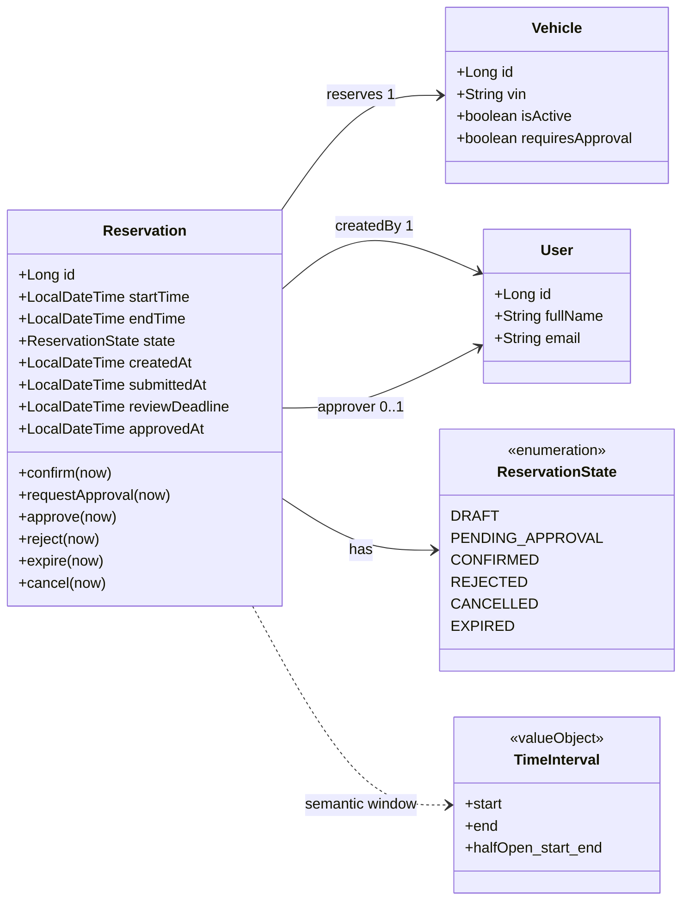
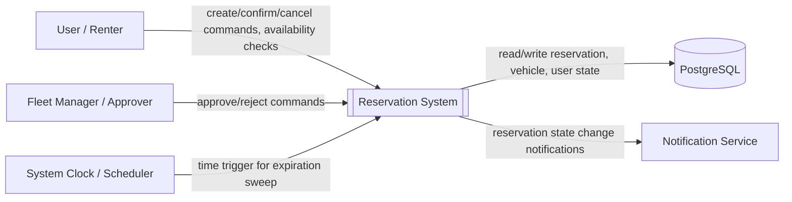
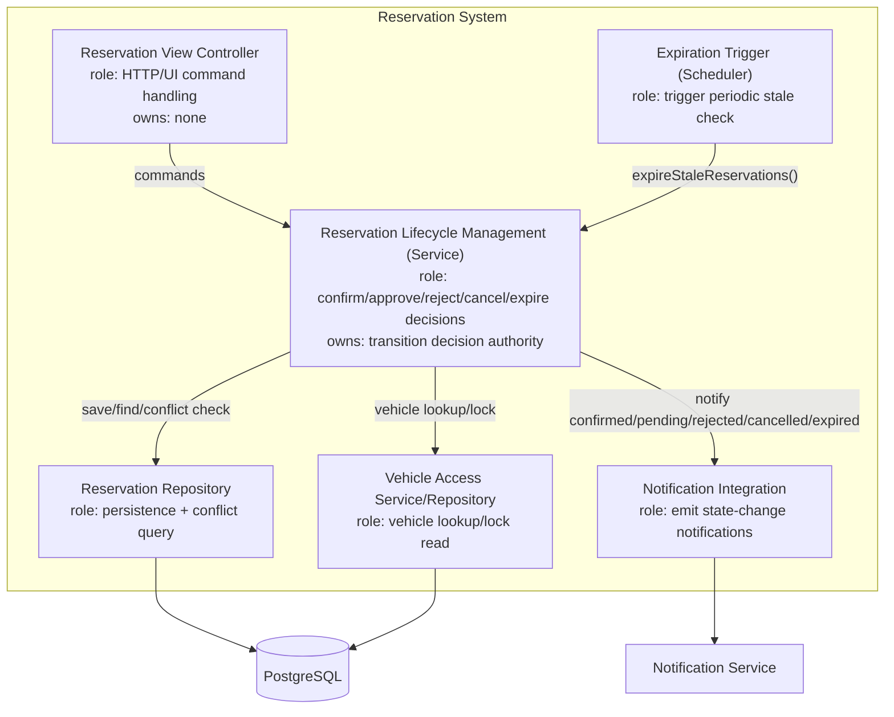
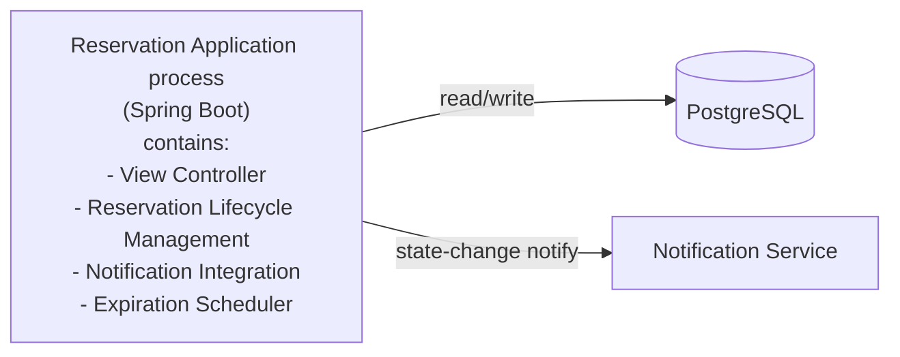
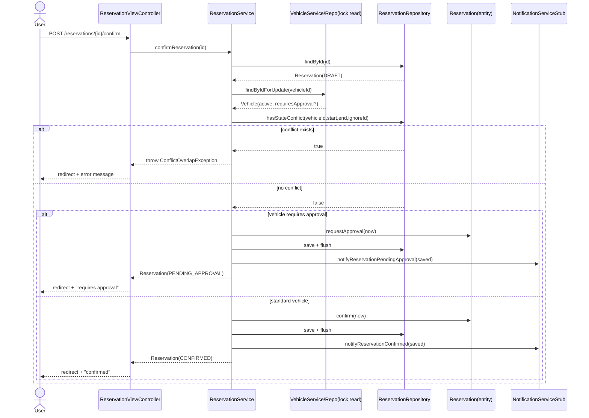
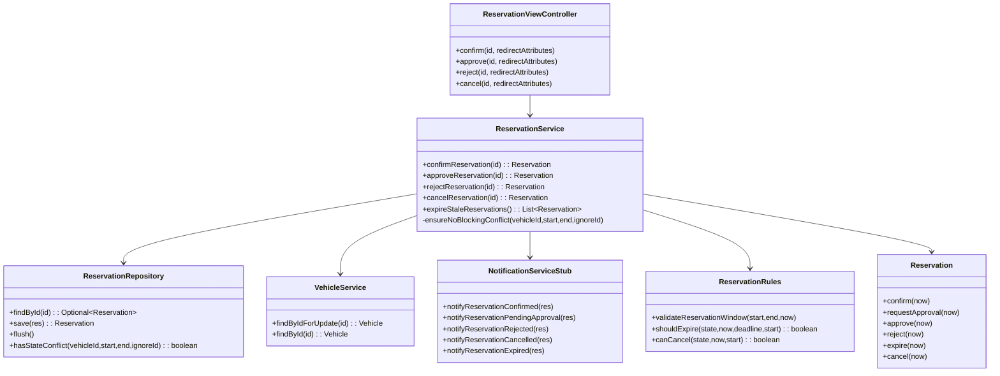

## C03 — Architecture Evidence

# Architecture Drivers (Baseline v0.2)

**Baseline:** v0.2  
**Selected scenario:** OP-03 Confirm Reservation (with delayed approval + conflict branch)[cite: 3]  
**AS-IS input source:** `docs/specification/C03/C03-PartA-Mapping(Confim-Reservation).md`

---

### B. Refined Architecture Drivers

| Driver | Evidence / Source | Why It Matters (Architectural Impact) | Core Question the Architecture Must Answer |
|---|---|---|---|
| **D1 — Concurrency Race Conditions (BR-02)** | `ReservationService.confirmReservation(...)`; `ReservationRepository.hasStateConflict(...)` | If two users click "Book" for the exact same car at the exact same millisecond, both requests might check the database, see that the car is free, and proceed. | How do we lock the resource (e.g., database row lock, serializable transaction, or constraint) so double-booking is physically impossible?[cite: 3] |
| **D2 — Asynchronous Human Workflow** | State machine (`DRAFT` $\rightarrow$ `PENDING_APPROVAL` $\rightarrow$ `CONFIRMED`/`REJECTED`/`EXPIRED`) | Standard bookings finish in a single HTTP request, but luxury bookings pause in a pending state, wait hours for human review, and branch into different outcomes.| Which service controls and coordinates this long-running lifecycle between user requests and manual manager decisions? |
| **D3 — Automated Timeouts / Deadlocks (BR-06)** | `ReservationExpirationScheduler`; BR-06; `ReservationService.expireStaleReservations()` | If an approver ignores a luxury request, the car cannot stay locked forever; stale requests will block cars and distort inventory. | How does the system reliably run a background timekeeper to expire old requests and release holds automatically? |
| **D4 — External System Failures** | External Notification Boundary; Post-commit email dispatchers | Sending an external email or SMS can fail or run slowly; linking external calls directly to the database transaction risks rolling back valid bookings or hanging connections. | If saving to PostgreSQL succeeds but the email crashes, do we roll back the whole booking or let it succeed and retry the message in the background? |
---

### C1. Updated Domain Class Model (focused slice)

**Business-significant multiplicities/constraints**
1. One `Reservation` references exactly one `Vehicle` and one requesting `User`; approver is optional.
2. BR-02: no overlap for same vehicle among blocking states `{CONFIRMED, PENDING_APPROVAL}`.
3. BR-01: interval semantics are half-open `[start,end)` with strict `start < end`.

---

### C2. Significant Responsibilities and Ownership Need

| Source | Responsibility | What it must decide / own | Needs one clear owner? | Reason |
|---|---|---|---|---|
| OP-03 + statechart | Decide confirm transition path | `DRAFT -> CONFIRMED` vs `DRAFT -> PENDING_APPROVAL` | yes | Must be deterministic and policy-driven |
| BR-02 | Enforce conflict invariant under command execution | authoritative “can transition?” decision under overlap/concurrency | yes | Invariant must not depend on caller timing |
| BR-05/06 | Manage pending approval lifecycle | approve/reject/expire legality and state mutation | yes | State survives request and has delayed events |
| BR-06 + scheduler | Execute expiration sweep | identify stale pending reservations and transition to `EXPIRED` | yes | Temporal consistency owner must be singular |
| External notification boundary | Emit business events after transition | integration side effect + failure semantics | design-dependent | External failures require explicit semantics |
| MVC flow | Translate domain outcomes to UX | error/success mapping only | yes (separate from domain decisions) | Prevent controller from becoming lifecycle owner |

**Must be grouped (shared invariant/state)**
- Confirmation decision, conflict guard, and reservation lifecycle mutation should be grouped in one lifecycle owner (application/domain service boundary around `ReservationService` + `Reservation` state methods).

**Should be separated**
- Notification integration should be isolated from core lifecycle decision logic (different failure boundary and change cadence).
- UI controller should not own transition decisions (different responsibility and trust boundary).

---

### D. Main Decision Question

**Decision question:**  
Where should the authoritative confirmation and lifecycle-transition decision be owned so BR-02 remains true under concurrency while still supporting delayed approval and expiration?

---

### E1. Two Materially Different Alternatives

#### Alternative A — In-process lifecycle ownership (single deployable)
- `ReservationService` is authoritative lifecycle owner.
- It orchestrates lock/read, conflict decision, transition call on `Reservation`, persistence, and event notification call.
- Scheduler invokes the same owner (`expireStaleReservations`) for timed transitions.

#### Alternative B — Split command/runtime ownership
- Web app accepts command and delegates confirm/approval/expiration decisions to a separate worker/service runtime element.
- Worker/service becomes authoritative owner and persists transitions; web tier only forwards requests and shows status.

---

### E2. Compare Alternatives Against Drivers

| Driver / criterion | Alternative A (single deployable owner) | Alternative B (separate worker/service owner) |
|---|---|---|
| D1 consistency under concurrency | Strong local transaction boundary around command handling; fewer distributed race edges | Can be strong but requires inter-process coordination/message semantics and stricter idempotency model |
| D2 delayed approval ownership | Same owner handles immediate + delayed transitions coherently | Clear ownership possible, but introduces command handoff and eventual visibility delays |
| D3 expiration consistency | Scheduler directly invokes same lifecycle owner; simple model | Expiration naturally fits worker, but operational split increases tracing complexity |
| D4 notification semantics | Easy to keep “state commit first, notify after”; retry can be isolated later | Better long-term resilience patterns possible, but more moving parts now |
| Operational complexity | Low (fits current app shape) | Higher (new runtime element, deployment, monitoring, queue/protocol) |

---

### E3. Same Significant Scenario Walkthrough (with concurrency complication)

| Step / event | Alternative A | Alternative B |
|---|---|---|
| Confirm Reservation starts | Controller calls in-process lifecycle owner (`ReservationService.confirmReservation`) | Controller submits command to external owner/worker |
| Approval required | Owner branches by `vehicle.requiresApproval` -> `PENDING_APPROVAL`, sets `submittedAt/reviewDeadline` | External owner performs same branch and state write |
| Initiating request/process ends | HTTP request completes immediately after in-process commit | HTTP may return accepted/pending command outcome before worker commit |
| Approval arrives later | `approveReservation` handled by same owner, same invariants | Approval command routed again to external owner |
| Concurrency event (2 overlapping confirms) | Must be prevented inside owner transaction/locking boundary; invariant anchored at same owner | Must be prevented inside external owner, plus idempotent command handling across boundaries |

**Conclusion from walkthrough:** both are feasible, but A gives lower complexity with direct fit to current implementation and still supports all required transitions.

---

### F. ADR

#### ADR-03 — Ownership of confirmation/lifecycle transition decisions under concurrency

**Context**  
Reservation confirmation must enforce BR-02 while supporting delayed approval (`PENDING_APPROVAL`) and timeout expiration (`EXPIRED`). Current system is a single Spring Boot deployable with service-layer orchestration and a scheduler.

**Drivers**  
D1 concurrency-safe exclusivity, D2 delayed approval ownership, D3 expiration ownership, D4 notification semantics, D5 verifiable dependency rule.

**Alternative A**  
Single deployable; `ReservationService` is lifecycle authority; state mutation via `Reservation` methods; scheduler reuses same owner.

**Alternative B**  
Separate runtime owner (worker/service) for lifecycle commands and delayed transitions.

**Decision**  
Accept **Alternative A** for current scope.

**Reason**  
It matches existing architecture, minimizes operational complexity, keeps transition and invariant ownership explicit in one place, and directly supports scenario + statechart transitions.

**Accepted negative consequences**
1. Notification integration is currently synchronous/stubbed in-process; resilience/retry is limited.
2. Scaling command processing independently is constrained compared to split-runtime design.
3. Concurrency guarantees still depend on correct transactional/locking implementation details.

**Reconsider when**
1. Throughput/contention at confirm/approve path exceeds single-runtime envelope.
2. Notification reliability requirements mandate durable asynchronous delivery.
3. Multi-service decomposition is introduced for broader platform reasons.

---

### G1. System Context Diagram

---

### G2. TO-BE Static Architecture (accepted)

**Primary responsibility ownership mapping**
- Lifecycle transition decisions: **Reservation Lifecycle Management**
- Conflict invariant gate (BR-02): **Reservation Lifecycle Management + Reservation Repository query boundary**
- Pending approval timeout transitions: **Reservation Lifecycle Management** (triggered by scheduler)
- Notification side effects: **Notification Integration**
- UX messaging only: **Reservation View Controller**

---

### G3. Transition Ownership (statechart overlay)

| Transition | Decision owner | Who may only request |
|---|---|---|
| `DRAFT -> PENDING_APPROVAL` | Reservation Lifecycle Management (`confirmReservation`) | View Controller / User command |
| `DRAFT -> CONFIRMED` | Reservation Lifecycle Management (`confirmReservation`) | View Controller / User command |
| `PENDING_APPROVAL -> CONFIRMED` | Reservation Lifecycle Management (`approveReservation`) | View Controller / Approver command |
| `PENDING_APPROVAL -> REJECTED` | Reservation Lifecycle Management (`rejectReservation`) | View Controller / Approver command |
| `PENDING_APPROVAL -> EXPIRED` | Reservation Lifecycle Management (`expireStaleReservations`) | Scheduler trigger only |
| `DRAFT/PENDING_APPROVAL/CONFIRMED -> CANCELLED` | Reservation Lifecycle Management (`cancelReservation`) | View Controller / User command |

---

### G4. Runtime / Deployment Mapping

**Mapping of G2 elements**
- Same process: VC, RM, NR, EX, RP/VP integration points.
- External runtime systems: PostgreSQL, Notification Service.

---

### H1. Design Sequence Diagram (same scenario + conflict branch)

---

### H2. Focused Design Class Diagram (scenario-supporting)

---

### I. Cross-View Check

| Check | Result | Issue found? | Resolution |
|---|---|---|---|
| C02 ↔ G2 | PASS | No | Required confirm/approval/reject/expire/cancel behavior represented by lifecycle owner |
| C2 ↔ G2 | PASS | No | Each significant responsibility has primary owner |
| G2 ↔ H1 | PASS | Minor | Sequence kept only allowed deps (controller->service->repo/service integrations) |
| H1 ↔ H2 | PASS | No | Every significant message has structural owner |
| statechart ↔ G3/H1 | PASS | No | Transition owners aligned with service methods/scheduler trigger |
| G2 ↔ G4 | PASS | No | Logical elements mapped to single deployable + DB + external notification |
| ADR ↔ G2/G4 | PASS | No | Accepted in-process ownership explicitly visible |

---

### J. AS-IS → TO-BE Delta

| Area | AS-IS | TO-BE | Action |
|---|---|---|---|
| Lifecycle decision ownership | `ReservationService` + `Reservation` methods | same | KEEP |
| Controller dependency direction | controller calls service only | same | KEEP |
| Delayed approval ownership | service owns `approve/reject/expire` | same | KEEP |
| Notification integration isolation | separate service (`NotificationServiceStub`) called by lifecycle owner | same (boundary retained; resilience can evolve) | KEEP |
| BR-02 conflict gate placement | service guard + repository overlap query | same owner, but must be concurrency-robust | VERIFY |
| Architecture rule enforcement evidence | implicit by coding style | explicit repeatable check required | CHANGE (documentation + check artifact) |

---

### K. Implementation Update

**Code restructuring required by accepted design:** none major (current structure already matches accepted ownership model).  
**CHANGE performed for C03:** add explicit architecture-conformance verification rule/check artifact (L2).  
**Commit/tag:** `<fill with actual commit/tag after adding check artifact>`

---

### L1. Behaviour Verification

| Verification | Result | Evidence |
|---|---|---|
| OP-03 success path for luxury -> `PENDING_APPROVAL` | PASS | `ReservationLifecycleIntegrationTest.luxuryReservationInPendingApprovalBlocksAvailability` |
| Alternative/failure path: overlap conflict rejected | PASS | same integration test, second confirm attempt throws |
| Pending approval later transition to confirmed | PASS | `approvingPendingLuxuryReservationSucceedsWithoutSelfConflict` |
| Temporal boundary: stale pending expiration | PASS | `stalePendingApprovalExpires` |
| Rule-level interval/cancellation/expiry helpers | PASS | `ReservationRulesTest` |

---

### L2. Architecture Rule Verification

**Architecture rule:**  
Only `ReservationService` may trigger `Reservation` lifecycle state mutation methods (`confirm`, `requestApproval`, `approve`, `reject`, `expire`, `cancel`) in production code.

**Check (repeatable):**  
Repository grep-based rule check in CI/local script:
1. Search all `src/main/java` for direct calls to `Reservation.(confirm|requestApproval|approve|reject|expire|cancel)\(`.
2. Exclude `ReservationService.java`.
3. Expected result: zero matches.

**Result:**  
PASS on current codebase (state mutation calls centralized in `ReservationService`).

---

### M. Remaining uncertainty / risk

1. Concurrency guarantee for BR-02 depends on concrete transaction isolation/locking behavior; current flow uses `hasStateConflict(...)` query and row lock on vehicle, but this should be stress-tested under parallel confirms.
2. Notification boundary is a stub; production-grade retry/idempotency semantics are not yet implemented.
3. Scheduler-driven expiration is periodic; exact SLA precision depends on trigger interval and clock consistency.

**Commit/tag:** `<fill exact commit/tag>`