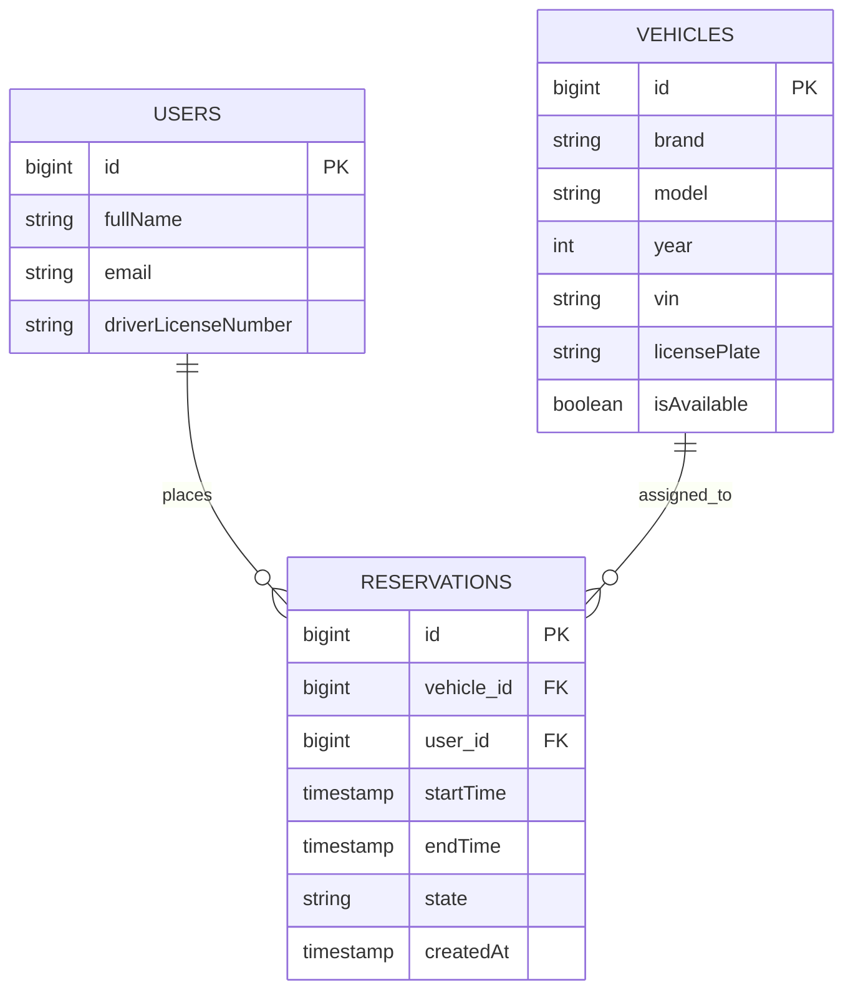

# AutoRepo — System Initialization & Core Domain Setup

Implement the end-to-end walking skeleton for AutoRepo.

### Mandatory Prerequisites & Conventions

1. Consult `architecture-and-decisions.md` for package conventions, boundaries, and tech stack configurations.

2. Consult `ui-specification.md` for DaisyUI (`data-theme="dim"`) styling, layout structures, and atomic component implementations.

3. Consult `intent-and-change.md` for core invariants, business rules, and domain state lifecycles.

4. Base package must strictly be: `cz.vsb.autarepo.autorepo`.

5. All domain logic must reside inside `cz.vsb.autarepo.autorepo.feature.<feature_name>`.

6. Controllers must never query repositories directly; always access data via services.

7. Views reside under `templates/feature/<feature-name>/` and map via `return "feature/<feature-name>/<view-name>";`.

8. **Database Documentation Protocol:** Whenever database entities are initialized or altered, generate or update a Mermaid Entity-Relationship Diagram (ERD) at `docs/architecture/erd.mmd` reflecting the exact schema, columns, constraints, and cardinalities.

Execute the setup in the following 6 phases:

## Phase 1: Infrastructure & Runtime Configuration

Generate the environment configuration files at the project root:

1. **`docker-compose.yml` (Project Root):**
    - Service `postgres`: Image `postgres:16`, container name `local_postgres`, port mapping `5432:5432`, database `autorepodb`, user `postgres`, password `mysecretpassword`, volume `pgdata:/var/lib/postgresql/data`.

    - Service `pgadmin`: Image `dpage/pgadmin4:latest`, port `5050:80`, depends on `postgres`, auto-loading connection profile from `./servers.json`.

    - Volume definition: `pgdata:`.

2. **`servers.json` (Project Root):**
    - Server profile connecting to host `postgres` on port `5432`, DB `autorepodb`, username `postgres`.

3. **`src/main/resources/application.yml`:**
    - Server port `8080`.

    - Datasource: `jdbc:postgresql://localhost:5432/autorepodb`, username `postgres`, password `mysecretpassword`, driver `org.postgresql.Driver`.

    - JPA: Hibernate `ddl-auto: update`, `show-sql: true`, `format_sql: true`.

    - Thymeleaf: `cache: false`.

## Phase 2: Global UI Framework & Cross-Cutting Architecture

Establish global layout fragments and cross-cutting error handling:

1. **Global Shell (`src/main/resources/templates/layout/base.html`):**
    - Head loading Tailwind Play CDN and DaisyUI CSS CDN.

    - Root set to `<html lang="en" data-theme="dim">`.

    - Header importing navbar fragment, flash container importing alert fragment, main container with dynamic replacement slot, and footer.

2. **Atomic UI Fragments (`src/main/resources/templates/components/`):**
    - **`navbar.html`:** DaisyUI navbar featuring links to Fleet (`/vehicles`) and Reservations (`/reservations`), with conditional `active bg-base-300` marking.

    - **`alert.html`:** DaisyUI alert banners for `successMessage` (`alert-success`) and `errorMessage` (`alert-error`).

    - **`forms.html`:** Parameterized Thymeleaf input wrappers showing label, input box with `input-bordered`, and Jakarta error span bindings.

3. **Status Error Pages (`src/main/resources/templates/error/`):**
    - **`404.html`:** Centered DaisyUI card with resource-not-found message and return button to `/vehicles`.

    - **`500.html`:** Centered DaisyUI card displaying server failure warning.

4. **Global Exceptions (`cz.vsb.autarepo.autorepo.common.exception`):**
    - `ResourceNotFoundException.java`: Custom runtime exception.

    - `GlobalExceptionHandler.java`: `@ControllerAdvice` capturing `ResourceNotFoundException` (renders `error/404`) and generic `Exception` (renders `error/500`).

## Phase 3: Backend Domain Modules & Schema Documentation

Implement the three modules strictly inside `cz.vsb.autarepo.autorepo.feature.*` and synchronize the database documentation:

### 1. User Module (`cz.vsb.autarepo.autorepo.feature.user`)

- **`User.java`:** JPA entity with `id` (Long, `@GeneratedValue`), `fullName`, `email`, `driverLicenseNumber`.

- **`UserRepository.java`:** Spring Data JPA repository extending `JpaRepository<User, Long>`.

- **`UserService.java`:** Basic lookup methods (`findAll()`, `findById(Long id)`).

### 2. Vehicle Module (`cz.vsb.autarepo.autorepo.feature.vehicle`)

- **`Vehicle.java`:** JPA entity with `id`, `brand`, `model`, `year` (int), `vin` (String), `licensePlate` (String), `isAvailable` (boolean).

- **`VehicleRepository.java`:** Spring Data JPA repository with derived query `findByIsAvailableTrue()`.

- **`dto/VehicleForm.java`:** Java 21 record for form binding with Jakarta annotations (`@NotBlank` on brand/model/licensePlate, `@Size(min=17, max=17)` on VIN, `@Min`/`@Max` on year).

- **`VehicleService.java`:** Handles fleet queries, retrieval, toggle availability, vehicle registration, and deletion.

- **`VehicleViewController.java`:** `@Controller` mapping `/vehicles` endpoints to render feature views.

### 3. Reservation Module (`cz.vsb.autarepo.autorepo.feature.reservation`)

- **`ReservationState.java`:** Enum declaring `DRAFT`, `CONFIRMED`, `CANCELLED`.

- **`Reservation.java`:** JPA entity with `id`, `@ManyToOne Vehicle`, `@ManyToOne User`, `startTime` (LocalDateTime), `endTime` (LocalDateTime), `@Enumerated ReservationState`, `createdAt` (LocalDateTime).

- **`ReservationRepository.java`:** Spring Data JPA repository containing the exact interval overlap helper:

  ```java
  boolean existsByVehicleIdAndStateAndStartTimeLessThanAndEndTimeGreaterThan(
      Long vehicleId, ReservationState state, LocalDateTime requestedEnd, LocalDateTime requestedStart
  );
  ```

- **`dto/ReservationForm.java`:** Java 21 record capturing `vehicleId` (`@NotNull`), `userId` (`@NotNull`), `startTime` (`@NotNull`), and `endTime` (`@NotNull`).

- **`NotificationServiceStub.java`:** Boundary service logging simulated notifications when reservation state updates.

- **`ReservationService.java`:** Invariant enforcement:
    - **Advance Window:** Start time must be at least 2 hours from `LocalDateTime.now()`.

    - **Max Duration:** Reservation duration cannot exceed 14 days.

    - **Overlap Rule:** Confirming a reservation checks the overlap helper for state `CONFIRMED`. Rejects transition if conflicting.

    - **Lifecycle:** Handles state transitions (`DRAFT` → `CONFIRMED` and `CANCELLED`), triggering `NotificationServiceStub`.

- **`ReservationViewController.java`:** `@Controller` mapping `/reservations` routes.

### 4. Database Schema Documentation (`docs/architecture/erd.mmd`)

Generate and keep synchronized the Mermaid Entity-Relationship Diagram representing the initial schema:



## Phase 4: Feature View Implementations

Build the presentation templates corresponding to the backend modules:

### 1. Vehicle Feature Views (`src/main/resources/templates/feature/vehicle/`)

- **`list.html`:** Table with zebra stripes, displaying Brand, Model, License Plate (`font-mono`), VIN (`font-mono text-xs`), Status badge (`badge-success` if available, `badge-neutral` if not), `+ Add Vehicle` button, and row actions (Reserve, Edit, Delete).

- **`form.html`:** Centered card form submitting to `/vehicles` with inputs for brand, model, year, license plate, VIN, and Cancel/Save buttons.

### 2. Reservation Feature Views (`src/main/resources/templates/feature/reservation/`)

- **`list.html`:** Table showing ID, Vehicle details, Driver name, Start/End times (`tabular-nums`), status badges (`DRAFT`: yellow, `CONFIRMED`: green, `CANCELLED`: red), `+ New Reservation` button, and row action triggers for Confirm and Cancel.

- **`form.html`:** Centered card form with dropdowns for Vehicle and User, start and end `datetime-local` pickers, conflict warning alert, and Submit/Cancel buttons.

## Phase 5: Verification Integration Spike Test

Create `src/test/java/cz/vsb/autarepo/autorepo/reservation/ReservationPersistenceSpikeTest.java`:

- Annotated with `@SpringBootTest`.

- Persists a sample `User` and `Vehicle` to PostgreSQL.

- Persists a `Reservation` with `CONFIRMED` state referencing both entities.

- Fetches the entity via `reservationRepository.findById(...)` and uses AssertJ assertions to verify relationship links, persistence integrity, and timestamp accuracy.

## Phase 6: Legacy Code & Workspace Pruning

Scan, identify, and eliminate obsolete artifacts, deprecated scaffolding, and unused legacy assets:

1. **Stale Source & Package Pruning:**
    - Remove any legacy packages outside `cz.vsb.autarepo.autorepo.feature.*` and `cz.vsb.autarepo.autorepo.common.*` (e.g., deprecated `controller/`, `model/`, `dao/`, or starter tutorial boilerplate).
    - Delete unused prototype entities, repository stubs, or legacy DTOs replaced by the new record-based models.

2. **Template & Asset Cleanup:**
    - Delete deprecated Thymeleaf templates located directly in `templates/` root or unnamespaced subfolders (e.g., `templates/home.html`, old prototype forms).
    - Remove unneeded static assets (e.g., placeholder CSS/JS files superseded by Tailwind Play CDN and DaisyUI).

3. **Build & Config Verification:**
    - Ensure `src/main/resources/application.properties` is removed if `application.yml` is used, preventing dual-configuration confusion.
    - Run a full clean build (`./mvnw clean compile` or `./gradlew clean build -x test`) to confirm that deleted classes have not left broken imports across remaining source files.
